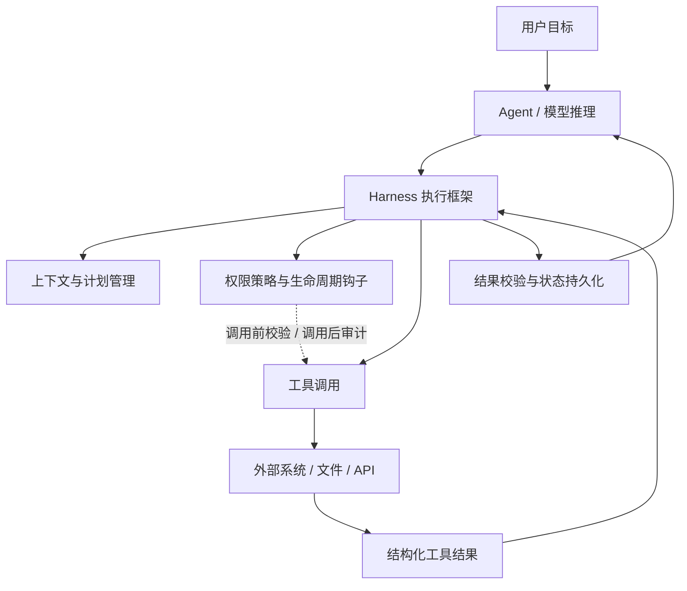
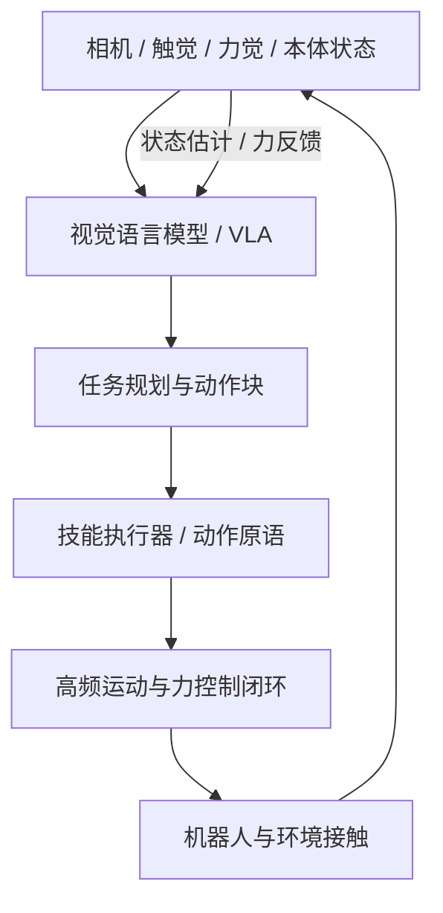
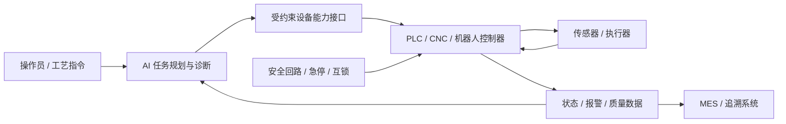

# AI 技术与产业周报｜2026-W47

- **覆盖周期**：2026-11-16 至 2026-11-22（周一至周日）
- **编制日期**：2026-11-24
- **口径**：仅纳入本周发生或正式发布的进展；厂商自述与论文结果均明确标注，不把演示等同于量产落地。

## 图文导读

> 图片用于帮助理解技术对象与应用场景；若不是事件现场照片，会明确标注为“产品/场景示意”，不冒充本次发布现场。

### 本周重点技术对象

<table>
<tr>
<td width="50%">

**Vera Rubin AI 训练基础设施**

图片：NVIDIA 官方 AI Training 页面。用于展示 Vera Rubin 机架级计算系统，非本期 MLPerf 测试现场照片。

[图片与平台资料：NVIDIA](https://www.nvidia.com/en-au/solutions/ai/ai-training/)

</td>
<td width="50%">

**CNC 机器人上下料单元**

图片：三菱电机工业自动化官方资料中的典型 CNC 机器人上下料单元；不是 JIMTOF 2026 展示现场照。

[应用场景资料：Mitsubishi Electric](https://us.mitsubishielectric.com/fa/en/resources/blog/assets/lights-out-manufacturing/)

</td>
</tr>
</table>

### 图解一：Agent Harness 在系统中的位置

下面是根据 AWS 本周公开的 Harness 能力整理的概念架构，不是 AWS 官方原图。

**工程解读：** 模型负责理解目标和提出下一步；Harness 负责任务状态、上下文、权限、工具生命周期和恢复。对工业系统，设备写操作必须经过确定性校验与人工授权边界，不能让模型直接绕过 PLC 联锁。

### 图解二：具身智能的分层闭环

下图概括 ScaleVLA 与 ForceHarness 所代表的两类研究关注点：上层多模态模型生成动作意图，下层控制环处理高频物理反馈。

**工程解读：** 任务规划与实时控制应分层。模型可以决定“抓取、插入、旋转”等目标，伺服控制器负责毫秒级反馈、限幅、碰撞检测和安全停止。

### 图解三：AI 进入工业单元的推荐架构

**工程解读：** AI 位于任务层和辅助决策层；PLC/CNC/机器人控制器仍承担确定性控制与安全功能。接口需要白名单、参数范围校验、审计日志和仿真验证。

---

## 本周要点

1. **模型竞争继续向“专业工作流 + Agent 执行”分层**：OpenAI 发布 GPT-6.2 Astra/Sol，Google 发布 Gemini 4 Neon；阿里发布 Qwen4-Max。厂商都在强调复杂任务、编程和多步骤工作，而不只是单轮问答。
2. **Agent 工程重点从模型转向 Harness**：AWS 将 Strands Harness 能力引入 Bedrock AgentCore，增加生命周期钩子、上下文管理、计划恢复、子代理和工具权限治理。对生产级 Agent 来说，可控执行流程开始成为产品核心。
3. **具身智能出现两项值得跟踪的研究**：ScaleVLA 研究把 552B 视觉语言模型作为 VLA 主干；ForceHarness 把力觉闭环与物理量解释封装成工具，让冻结模型参与接触丰富的操作任务。两者都强调模型之外的控制/执行层。
4. **工业现场的 AI 形态更具体**：三菱电机展示语音任务规划、MCP 控制 CNC、ROS 连接人形机器人的加工单元；韩国药厂项目则把视觉质检、剔除机器人、振动预测维护和 GMP 数据系统连起来。但前者仍是验证研究，不能视为成熟商品。
5. **AI 基础设施有可量化的新基准结果**：NVIDIA Vera Rubin 在 MLPerf Training v6.1 首次参赛，多项训练测试领先；Q.ANT 展示光子 NPU 的光学 DFT 能力，仍需独立、端到端能效验证。
6. **AI 眼镜本周缺少可确认的重大新品/功能发布**：Meta 可查到的 v30 更新发布日期为 11 月 11 日，早于本期。不能把上一周的语言和地区扩展重复包装成本周进展。

---

## 1. 基础模型与模型研发

### 1.1 OpenAI 发布 GPT-6.2 Astra 与 GPT-6.2 Sol

- **日期**：2026-11-17
- **进展**：OpenAI 将模型分为偏高难度推理、编程和复杂专业任务的 Astra，以及更强调速度、成本和多步骤日常工作的 Sol。官方模型发布说明称两者在高难度任务上优于前代，同时输出 token 更少；API 支持 Responses 与 Chat Completions，工具调用要求使用 Responses API。
- **意义**：产品路线呈现“高能力旗舰 + 高效率执行模型”的分层。对 Agent 系统而言，模型选择不应只看榜单分数，还要同时评估工具调用可靠性、任务完成率、延迟、上下文成本和重试成本。
- **证据性质**：官方产品/API 发布；性能结论为厂商说明，尚不能仅凭发布说明视为独立验证。
- **来源**：
  - [OpenAI Model Release Notes（Nov 17）](https://help.openai.com/en/articles/9624314-model-release-notes)
  - [OpenAI API Changelog（Nov 17）](https://developers.openai.com/api/docs/changelog)

### 1.2 Google 发布 Gemini 4 Neon

- **日期**：2026-11-18
- **进展**：Google 将 Gemini 4 Neon 定位为面向复杂软件工程、知识工作和科学工作流的模型。Google 公布其在 Artificial Analysis Intelligence Index 的 xhigh thinking 档得分为 61，并称在 Agent Arena 的 steerability 指标排名靠前。
- **意义**：厂商开始把“执行过程中接受用户纠正、按中途反馈调整”作为 Agent 体验的重要能力，而非只强调一次性回答质量。实际开发中应测试长任务中途改变需求、纠正错误和恢复上下文的能力。
- **证据性质**：官方发布；榜单名次与得分应结合榜单版本、测试配置和第三方复测理解。
- **来源**：[Google：Introducing Gemini 4 Neon](https://blog.google/innovation-and-ai/models-and-research/gemini-models/introducing-gemini-4-neon/)

### 1.3 阿里发布 Qwen4-Max

- **日期**：2026-11-16
- **进展**：阿里云发布 Qwen4-Max，官方披露总参数 2.4T、每 token 激活约 71B，具备原生视觉能力和百万 token 上下文，面向编程、办公、研究及 Agent 任务。当前通过云端服务/API 提供；阿里称后续会发布 Qwen4 系列较小规模开源权重模型。
- **意义**：超大总参数与稀疏激活继续并行发展。对应用方，实际成本不只由总参数决定，还取决于激活参数、KV Cache、上下文长度、并发、路由策略和服务定价。不要将 Qwen4-Max 本身误认为已开放权重。
- **证据性质**：官方产品发布；参数与能力数据为厂商披露。
- **来源**：
  - [Alibaba Cloud：Qwen4-Max 发布公告](https://www.alibabacloud.com/en/press-room/alibaba-unveils-qwen4-max)
  - [Model Studio 模型更新记录](https://www.alibabacloud.com/help/zh/model-studio/newly-released-models)

### 1.4 Microsoft Ignite 发布专业模型组合

- **日期**：2026-11-17（Ignite 会议 11 月 17–20 日）
- **进展**：Microsoft 在 Ignite 宣布面向编程和网络安全等场景的新模型，包括 MAI Code 2 与安全方向模型；Reuters 报道称 MAI Code 2 旨在以较低成本接近竞争模型表现，安全模型先向有限客户开放。
- **意义**：大厂不再只依赖一个通用旗舰模型，而是通过领域模型、模型路由和成本控制争夺企业 Agent 工作负载。企业采购应要求同一任务集上的质量、成本和延迟对照，而非只比较厂商榜单。
- **证据性质**：Microsoft 官方会议公告确认发布方向；具体性能比较主要来自厂商主张及媒体报道。
- **来源**：
  - [Microsoft Ignite 2026 官方发布](https://news.microsoft.com/source/2026/11/17/microsoft-ignite-2026-empowering-human-ambition-intelligence-and-trust/)
  - [Reuters：Microsoft unveils AI models for coding, cybersecurity](https://www.reuters.com/legal/litigation/microsoft-unveils-ai-models-coding-cybersecurity-it-takes-anthropic-openai-2026-11-17/)

### 1.5 Anthropic 公布 Claude 在黑洞理论物理问题上的研究协助

- **日期**：2026-11-17
- **进展**：Anthropic 称 Claude Fable 5.2 完成了两个黑洞理论物理相关开放问题的计算，并公开了对应预印本。
- **意义**：值得关注的是模型参与研究推导、计算和探索的工作流，而不是简单把“AI 解决物理难题”当作已完成科学发现。需要检查论文推导、假设、计算过程和领域专家复核。
- **证据性质**：研究团队案例说明及预印本；尚不等同于独立同行评审结论。
- **来源**：[Anthropic：Claude solves two open problems in the physics of black holes](https://www.anthropic.com/research/claude-black-hole-physics)

---

## 2. Agent 与 Harness

### 2.1 AWS Bedrock AgentCore Harness 引入 Strands 默认能力和生命周期钩子

- **日期**：2026-11-19
- **进展**：AWS 将开源 Strands Harness 集成到 AgentCore Harness，加入推荐模型和任务型系统提示、提示缓存、主动上下文管理、上下文卸载、跨调用计划恢复、子代理委派、网页检索和细粒度文件系统权限。新增生命周期钩子，可在调用前、工具执行前后及调用结束时运行确定性检查。
- **意义**：这比单纯增加工具更重要。Agent 的生产化瓶颈在于权限、上下文增长、工具副作用、任务恢复和可观测性。尤其是 `before_tool_call` 可在副作用发生前拦截操作，适合退款、设备控制、配置变更等敏感动作。
- **工程判断**：
  - 把“模型决策”与“确定性执行策略”分层：模型负责提出意图，程序负责校验权限、参数范围、状态机和安全互锁。
  - 对长任务持久化计划、工具结果和检查点，避免上下文压缩后丢失关键状态。
  - AWS 文档特别提示：若不固定 `allowedTools`，默认工具集可能随托管能力升级而变化；安全边界要求固定时，应显式列出允许工具。
- **证据性质**：官方产品能力公告；文中性能/成本改善属于 AWS 自述。
- **来源**：[AWS：AgentCore harness adds Strands defaults, built-in tools, and lifecycle hooks](https://aws.amazon.com/blogs/machine-learning/amazon-bedrock-agentcore-harness-adds-strands-harness-defaults-built-in-tools-and-lifecycle-hooks/)

### 2.2 Thinking Machines 发布 Inkling 2 Mini 开放权重模型

- **日期**：2026-11-20
- **进展**：Inkling 2 Mini 是 26.4B 总参数、3.4B 激活参数的 MoE 模型，采用 looped transformer：每个 token 的中间层重复运行三次。官方称其开放权重，Apache 2.0 许可，目标包括 Agent 编程和工具使用。
- **意义**：通过重复计算换取推理能力，是不同于单纯扩大参数量的效率路线。对本地部署，应实际测量重复层带来的时延、显存占用和吞吐，而不是只看激活参数量。
- **证据性质**：官方模型发布和模型卡；基准成绩为厂商报告，需独立复现。
- **来源**：
  - [Thinking Machines：Introducing Inkling 2 Mini](https://thinkingmachines.ai/news/inkling-2-mini/)
  - [Inkling 2 Mini Model Card](https://thinkingmachines.ai/model-card/inkling-2-mini/)

---

## 3. 具身智能

### 3.1 ScaleVLA：将 552B 视觉语言模型接入 VLA

- **日期**：2026-11-16（arXiv 提交）
- **进展**：论文提出 ScaleVLA，将 552B DeepSeek-V4.1-Flash 作为视觉语言主干，连接可训练的动作 DiT，并在统一训练设置下比较 2B 到 552B 的主干模型。论文报告：10 条示范达到 87.8% 成功率；LIBERO-PRO 达到 45.1%；真实充电器插入任务由 4/10 提升到 9/10；动作块中位延迟 216 ms。
- **意义**：研究问题从“能否把语言模型接到机器人上”转向“更大规模的通用视觉语言表征能否改善机器人样本效率、泛化和精细操作”。但 552B 主干的推理成本、系统延迟、部署硬件和真实场景覆盖仍是落地关键。
- **证据性质**：arXiv 预印本及作者实验报告；不是独立复现，也不是规模化部署证据。
- **来源**：[arXiv：ScaleVLA](https://arxiv.org/abs/2611.21607)

### 3.2 ForceHarness：把力觉闭环变成模型可调用的工具

- **日期**：2026-11-16（arXiv 提交）
- **进展**：ForceHarness 面向冻结的多模态模型，使用自终止力控原语在底层闭合快速力反馈回路，再把力信号转换成带不确定性的物理量，作为工具结果返回给模型。论文同时提出包含 7 个任务的 MuJoCo HiddenPhys 基准。作者报告，在一台没有腕部力传感器的真实机械臂上，GPT-6 Astra 零样本任务成功率由 3.3% 提升到 90%。
- **意义**：这是一种很有价值的系统分层：模型不直接承担高频、低延迟的伺服控制，而由传统控制环处理接触力，模型在较慢的任务层读取结构化物理反馈并决定下一步。对机器人安全和实时性，比“让大模型直接控制电机”更合理。
- **工程判断**：可以类比工业自动化中的上层任务规划与底层 PLC/运动控制分离。AI 输出目标和策略，确定性控制器执行闭环、限幅、互锁和急停。
- **证据性质**：arXiv 预印本及作者实验报告；单机械臂实验不能代表复杂工况普适能力。
- **来源**：[arXiv：ForceHarness](https://arxiv.org/abs/2611.21099)

---

## 4. AI 眼镜与第一视角智能设备

### 本周结论：未发现可确认的本周重大新品或核心功能发布

Meta 官方 AI 眼镜更新记录中，最近一项可核实的 v30 更新发布日期是 **11 月 11 日**，早于本期。其内容包括无显示眼镜新增多种语言支持和更多地区开放，但不应重复计为 11 月 16–22 日的新进展。

- **来源**：[Meta AI Glasses Release Notes](https://www.meta.com/help/ai-glasses/1809764829519902/)

### 观察判断

本周公开信息不足以证明 AI 眼镜在“连续第一视角记录—事件理解—长期视觉记忆—主动提醒”链条上出现了新突破。后续仍应重点追踪：

1. 是否支持全天或长时段连续采集，而不是用户主动拍摄；
2. 视觉数据如何切片、索引、压缩和检索；
3. 端侧与云端如何分工，真实续航和上传成本如何；
4. 是否能跨时间回答“之前在哪里见过/放过某物”等记忆问题；
5. 隐私提示、数据保留、旁观者授权和本地删除机制。

**本周不以旧功能更新或未证实传闻填充版面。**

---

## 5. 现实世界交互

### 5.1 三菱电机展示语音任务规划、CNC 与人形机器人协同加工

- **日期**：2026-11-19（报道日期；展示于 JIMTOF 2026）
- **进展**：系统将 AI 加工任务规划器、具备 Physical AI 能力的 CNC 和 Galaxea Dynamics 人形机器人结合。操作者通过语音指定加工内容，AI 生成加工程序；机器人装夹工件，CNC 加工，再由机器人取件。AI 与 CNC 使用 MCP 通信，机器人侧使用 ROS，网络可采用 Wi-Fi 或有线 LAN。
- **关键限制**：
  - 机器人动作依赖预先登记的任务库和设备能力描述；
  - 摄像头/传感器用于确认任务是否完成；
  - 工件摆放失败等情况仍可能报警，自动恢复尚在开发；
  - 启动加工、修改参数和 CNC 设置等物理动作需要人工批准；
  - 企业表示仍处于验证研究阶段，商业化计划未确定，约 2030 年才希望进入实用阶段。
- **意义**：这不是“语音直接控制机床”，而是自然语言任务规划器通过受约束的设备接口调用 CNC/机器人能力。MCP 负责上层工具接口，ROS 负责机器人系统通信，底层运动控制仍由设备控制系统承担。
- **证据性质**：行业媒体对展会演示的报道；企业明确表示仍在验证研究。
- **来源**：[Engineering.com：Mitsubishi Electric CNC work cell uses AI and humanoid robots](https://www.engineering.com/mitsubishi-electric-cnc-work-cell-uses-ai-and-humanoid-robots/)

---

## 6. 工业 AI 与自动化

### 6.1 韩国 WiseMedi 药厂引入 AI 视觉质检与预测性维护

- **日期**：2026-11-18
- **进展**：CJ OliveNetworks 将在 WiseMedi 第二工厂建设 AI 智能工厂。视觉系统检查药品包装封口不均、折叠等缺陷，并连接机器人剔除不良品；项目目标检测准确率至少 95%。同时采集主要旋转设备振动数据用于预测性维护，连接 40 多种检测设备，并打通 ERP/MES 批次、物料和灭菌记录。
- **意义**：工业 AI 的价值不只是视觉模型准确率，而是与剔除机构、设备状态、质量检测和批次追溯系统形成闭环。项目尤其强调 GMP 数据可靠性，说明数据治理和审计链是药品制造场景的重要约束。
- **证据性质**：项目建设公告及媒体报道；95% 是目标指标，不是已完成验收结果。
- **来源**：[The Korea Times：CJ OliveNetworks brings AI-powered inspections to pharmaceutical factory](https://www.koreatimes.co.kr/business/companies/20261118/cj-olivenetworks-brings-ai-powered-inspections-to-pharmaceutical-factory)

### 6.2 本周工业自动化的共同趋势

从三菱 CNC 协同加工和 WiseMedi 药厂项目可看到两条相对清晰的路线：

- **任务层智能化**：自然语言/多模态模型把工艺意图转换为受约束的任务计划，再通过 MCP、ROS 或设备 API 调用设备能力。
- **生产数据闭环**：视觉检测、振动数据、测试设备、MES/ERP 和批次记录形成可追溯链路。

对 PLC 和工业通信工程而言，真正的机会在设备能力建模、协议适配、状态机、异常恢复、确定性联锁、审计与仿真验证，而不是让 LLM 直接取代 PLC 扫描周期和安全回路。

本周未检索到足够可靠、明确发生在 11 月 16–22 日且具有实质进展的 PLC 固件、工业协议标准或现场总线重大更新，因此不编造该类新闻。

---

## 7. AI 硬件与基础设施

### 7.1 NVIDIA Vera Rubin 在 MLPerf Training v6.1 首次提交结果

- **日期**：2026-11-16
- **进展**：NVIDIA 公布 Vera Rubin NVL72 在 MLPerf Training v6.1 的结果。NVIDIA 称其在 7 项训练基准中的 6 项取得最快训练时间；DeepSeek-V3 671B 测试中，1,024 GPU 配置用时 4.14 分钟，相比同规模 GB300 NVL72 的 8.03 分钟约快 2 倍。官方还强调从 256 扩展到 1,024 GPU 时，DeepSeek-V3 测试的整体扩展效率超过 97%。
- **意义**：大模型训练的瓶颈不仅是单卡算力，还包括 GPU 间互连、网络、软件栈和集群扩展效率。对于 DPDK/网络开发者，超大规模训练集群的通信效率、拥塞控制、拓扑、RDMA/InfiniBand 或以太网栈仍是重要基础设施问题。
- **证据性质**：NVIDIA 对 MLPerf Training v6.1 提交结果的官方解读；应以 MLCommons 对应 submission 记录作为独立基准原始依据。NVIDIA 另行披露的未验证优化结果不应与正式 MLPerf 结果混为一谈。
- **来源**：[NVIDIA Technical Blog：Vera Rubin NVL72 in MLPerf Training v6.1](https://developer.nvidia.com/blog/nvidia-vera-rubin-nvl72-achieves-up-to-2x-blackwell-ultra-performance-in-mlperf-training-v6-1/)

### 7.2 Q.ANT 发布光子 NPU Gen 2+，展示光学 DFT

- **日期**：2026-11-17
- **进展**：Q.ANT 在 SC26 展示 NPU Gen 2+，新增直接在光学域执行离散傅里叶变换（DFT）的能力，并演示与 AMD GPU 组成混合系统运行大语言模型。
- **意义**：光子计算尝试把部分矩阵/变换运算从电子域迁移到光学域，可能在特定算子上获得带宽或能效优势。但系统价值取决于数据转换、存储、控制、精度、可编程性和端到端工作负载，而不是单个光学算子的速度。
- **证据性质**：厂商发布与展会演示；目前不应视为已在通用 LLM 生产部署中证明能效优势。
- **来源**：[Q.ANT：NPU Gen 2+ photonic Fourier transforms](https://qant.com/news/q-ant-unveils-npu-gen-2-plus-photonic-fourier-transforms-power-large-language-model/)

---

## 8. 前沿研究与开源生态

本周较值得关注的开放研究/模型：

| 项目 | 日期 | 价值 | 证据性质 |
|---|---|---|---|
| [ScaleVLA](https://arxiv.org/abs/2611.21607) | 11-16 | 研究超大视觉语言主干对 VLA 泛化和样本效率的影响 | arXiv 预印本 |
| [ForceHarness](https://arxiv.org/abs/2611.21099) | 11-16 | 将力控闭环、物理量解释封装为模型可调用工具 | arXiv 预印本 |
| [Inkling 2 Mini](https://thinkingmachines.ai/news/inkling-2-mini/) | 11-20 | Apache 2.0 开放权重，looped transformer + MoE | 官方发布/模型卡 |

本周未发现足够可靠且与用户关注的 C/LuaJIT/DPDK 协议仿真直接相关的重大开源版本发布。后续值得持续追踪的结合点是：Agent 自动生成协议测试用例、从 PCAP/日志中提取异常模式、基于仿真环境进行闭环验证，以及把协议规范转换为可执行测试约束。

---

## 对工程实践的影响

### 对 C/C++、Linux、DPDK 和协议仿真

1. **Agent 不应直接拥有无限系统权限**：AWS 生命周期钩子的思路可迁移到本地开发工具。将文件写入、编译、运行、网卡配置和设备控制划分权限域，在工具调用前校验参数与目标资源。
2. **长任务需要状态外置**：协议仿真、回归测试和大规模抓包分析通常跨越多个步骤。将计划、测试配置、PCAP 索引、运行日志和检查点存储在可追溯文件/数据库中，避免依赖上下文窗口记忆。
3. **AI 适合做分析层，不适合取代实时数据面**：DPDK 收包、转发、定时器和协议状态机仍应由确定性 C 代码执行；模型适合离线分析异常、生成测试场景、解释统计结果和辅助定位。
4. **把测试结果结构化**：Agent 生成的代码或配置必须经过编译、单元测试、协议一致性测试、流量回放、故障注入和性能回归。不能把“模型说已修复”作为验收依据。

### 对 PLC 与工业自动化

1. 建立设备能力描述和白名单工具接口，让模型生成“工艺任务”而不是直接输出任意控制指令。
2. PLC/运动控制器承担实时闭环、安全互锁、限幅和急停；AI 负责较慢的任务规划、诊断和人机交互。
3. 将状态机、设备反馈、报警码、批次记录和操作审计纳入 Agent 上下文。
4. 对 AI 生成的 PLC 逻辑或设备参数，先在数字孪生/仿真环境验证，再经过人工审批进入现场。

---

## 趋势判断与待验证问题

1. **Harness 正在成为 Agent 产品的核心差异点**：模型能力相近时，长任务管理、工具权限、上下文压缩、执行恢复和可观测性会明显影响实际生产表现。
2. **具身智能的关键不是单纯扩大 VLA 参数量**：ScaleVLA 关注表征规模，ForceHarness 关注接触物理反馈；两条路线共同说明，感知、动作生成和底层控制需要协同设计。
3. **工业 AI 更可能先从受约束的工艺单元进入**：视觉质检、预测维护、CNC 上下料和质量追溯比完全自主工厂更容易定义验收指标。
4. **AI 眼镜的关键差距仍在连续记忆链条**：本周没有确认的新突破。真正值得等待的是持续感知、低功耗索引、长期记忆和隐私控制的一体化能力。
5. **硬件比较要从峰值算力转向系统效率**：MLPerf 的集群结果提示互连和软件栈同样重要；光子计算则需要端到端能效和真实工作负载验证。

### 下周重点观察

- GPT-6.2 Astra/Sol、Gemini 4 Neon、Qwen4-Max 的第三方评测与真实开发者反馈。
- AgentCore/Strands 的生命周期钩子在复杂工具调用和安全策略上的实际效果。
- ScaleVLA、ForceHarness 是否出现代码、模型权重或独立复现实验。
- 三菱 CNC/机器人协同系统是否公布进一步技术资料或现场试验计划。
- AI 眼镜是否出现真正支持持续视觉记忆的新产品或软件能力。

---

## 来源核验说明

本期优先使用 OpenAI、Google、Alibaba Cloud、Anthropic、AWS、NVIDIA、Q.ANT 的官方公告/文档，以及 arXiv 论文和行业媒体的具体项目报道。厂商性能数字均保留“厂商报告”属性；论文结果保留“作者实验/预印本”属性；展会演示和建设目标不写成已规模化量产。未找到可靠新进展的方向明确留空，不以传闻填充。
